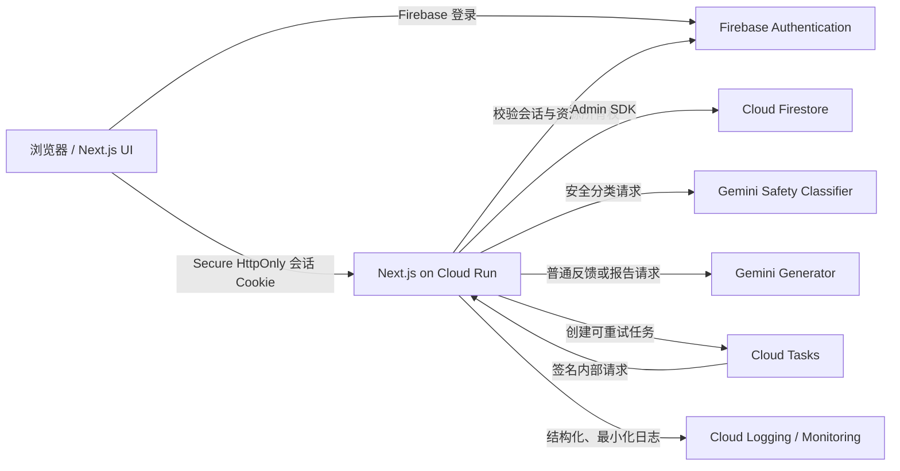

# MindTrace 系统架构

## 1. 架构目标

- 以简单的模块化单体完成 MVP，避免过早拆分微服务。
- 所有个人数据访问都经过服务端认证和授权。
- Gemini 密钥和服务账号凭据不进入浏览器。
- 日记、账户、分析、报告和运营状态按数据域隔离。
- AI 失败不阻塞记录主流程。
- 安全检测、普通生成和输出校验相互独立。
- 数据导出和永久删除是系统能力，不是人工操作。

## 2. 技术选择

| 层       | 选择                                     | 说明                                          |
| -------- | ---------------------------------------- | --------------------------------------------- |
| Web      | Next.js + TypeScript                     | App Router、响应式界面、服务端 Route Handlers |
| UI       | React + 项目内设计令牌                   | 首版不引入重型组件框架，优先无障碍原生控件    |
| 身份     | Firebase Authentication                  | 浏览器登录后换取服务端会话 Cookie             |
| 数据     | Cloud Firestore                          | 仅服务端 Admin SDK 访问业务数据               |
| AI       | `@google/genai` Provider adapter         | 仅 server-only；测试使用 Fake/SDK mock        |
| 运行环境 | Google Cloud Run                         | 部署整个 Next.js 模块化单体                   |
| 异步任务 | Cloud Tasks + Cloud Run 内部任务端点     | 用于可靠删除、可重试报告等长任务              |
| 验证     | 统一 schema 库                           | API 输入、环境变量和 AI 输出共用 schema       |
| 测试     | 单元、Firebase Emulator 集成、浏览器 E2E | 不使用真实用户数据                            |

具体稳定版本在开发阶段 1 选择并锁定，不在规划阶段安装依赖。

## 3. 高层结构



安全分类器和普通生成器可以使用同一供应商与模型系列，但必须是两个独立请求、独立 schema 和独立决策步骤。不得让一次自由生成同时承担风险判断和建议生成。

## 4. 应用边界

建议采用单仓库模块化结构：

```text
src/
  app/
    [locale]/
    api/v1/
  components/
  features/
    auth/
    consent/
    journal/
    trends/
    ai-feedback/
    reports/
    settings/
    safety/
  i18n/
  lib/
    auth/
    billing/
    env/
    firebase/
    logging/
    validation/
  server/
    ai/
    repositories/
    services/
    tasks/
tests/
  unit/
  integration/
  e2e/
  fixtures/
```

约束：

- React 组件不直接导入 Firebase Admin SDK、Gemini SDK 或服务账号配置。
- Route Handler 只负责协议转换；业务规则放在 service；Firestore 查询放在 repository。
- repository 的每个用户数据方法必须显式接收已经验证的 `userId`。
- 日记原文不得进入普通日志、异常上下文或分析事件。
- `src/i18n/messages/zh-CN.*` 保存首版界面文本，不把中文散落在业务逻辑中。

## 5. 身份与会话

1. 浏览器使用 Firebase Web SDK 完成邮箱密码登录。
2. 浏览器将短期 ID token 发送给 `/api/v1/auth/session`。
3. 服务端只验证 ID token 的真实性和有效性，然后设置 `HttpOnly`、`Secure`、`SameSite=Lax` 会话 Cookie。创建会话不要求用户已经完成成年确认或同意。
4. 新用户获得会话后可以访问 onboarding、consent、设置、产品边界和安全页面。
5. 成年确认和当前版本同意是个人功能的准入条件。未满足条件的已登录用户不能访问日记、趋势、AI 反馈或报告页面和 API。
6. 后续 API 只信任服务端验证后的会话，不信任请求体中的 `uid`。
7. 登出时清除 Cookie；敏感操作需要近期登录或重新认证。
8. 账户删除、邮箱变更等高风险操作要求近期认证。
9. 当前同源 Web 架构的所有状态变更请求严格校验 `Origin`，缺失或不匹配均拒绝，以此作为当前阶段的 CSRF 防护。未来如引入跨站客户端，再增加独立 CSRF token 或双重提交机制。

权限守卫分为两层：

- `requireSession`：只验证安全会话，供 onboarding、同意、设置和登出等流程使用。
- `requireProductAccess`：在 `requireSession` 基础上检查成年确认及当前必需版本同意，供日记、趋势、AI 反馈和报告使用。

Firebase Web 配置本身不是服务端密钥，但仍通过公开环境变量集中管理。Gemini 密钥、Admin 凭据和任务签名配置只能存在于服务端 Secret Manager 或本地忽略文件中。Cloud Run 使用服务账号身份，不提交 JSON 密钥。

## 6. 授权与 Firestore 访问

首版采用“浏览器不直连业务 Firestore”的策略：

- 浏览器只能调用同源 API。
- Firestore 安全规则默认拒绝所有客户端业务数据访问。
- Admin SDK 绕过规则，因此 API 必须执行会话验证、资源所有权检查和字段白名单更新。
- Emulator 测试同时验证客户端访问被拒绝，以及 API 不会跨用户返回数据。

规则策略示意：

```text
match /{document=**} {
  allow read, write: if false;
}
```

未来如为实时体验开放客户端读取，需要为单个集合单独设计 owner-only 规则，不得整体放宽。

## 7. Firestore 数据模型

所有时间使用 Firestore Timestamp 保存。所有文档禁止存储完整请求头、访问令牌和密钥。

### 7.1 `accounts/{uid}`

账户和偏好，不存日记正文。

| 字段                      | 类型        | 说明                           |
| ------------------------- | ----------- | ------------------------------ |
| `displayName`             | string/null | 可选                           |
| `locale`                  | string      | 初始为 `zh-CN`                 |
| `timeZone`                | string      | IANA 时区                      |
| `safetyRegion`            | string/null | 国家或地区代码，不是精确位置   |
| `adultConfirmedAt`        | timestamp   | 成年确认时间                   |
| `createdAt` / `updatedAt` | timestamp   | 服务端时间                     |
| `status`                  | string      | `active`、`deletion_requested` |

邮箱由 Firebase Authentication 管理，`accounts/{uid}` 默认不复制邮箱。只有未来出现明确业务需求并完成隐私评审后，才可增加邮箱副本及其同步、导出、删除和访问控制规则。

子集合 `accounts/{uid}/consents/{consentId}`：

基础产品同意文档 `2026-06-22-v1`：

| 字段                      | 类型      | 说明         |
| ------------------------- | --------- | ------------ |
| `privacyAccepted`         | boolean   | 必须为 true  |
| `privacyVersion`          | string    | 隐私文本版本 |
| `productBoundaryAccepted` | boolean   | 必须为 true  |
| `productBoundaryVersion`  | string    | 产品边界版本 |
| `acceptedAt`              | timestamp | 服务端时间   |
| `locale`                  | string    | 接受时语言   |

独立 AI 处理决定文档 `ai-processing-2026-06-25-v2`：

| 字段                  | 类型      | 说明                              |
| --------------------- | --------- | --------------------------------- |
| `accepted`            | boolean   | true 才允许向第三方 Provider 发送 |
| `aiProcessingVersion` | string    | AI 数据处理说明版本               |
| `decidedAt`           | timestamp | 接受或拒绝的服务端时间            |
| `locale`              | string    | 决定时语言                        |

基础产品访问不依赖 `accepted`。AI service 在真正调用配置 Provider 前单独检查该版本化决定。

### 7.2 `journals/{uid}/entries/{entryId}`

原始用户记录，与 AI 分析分离。

| 字段                      | 类型      | 说明                               |
| ------------------------- | --------- | ---------------------------------- |
| `mood`                    | number    | 1 到 10                            |
| `stress`                  | number    | 1 到 10                            |
| `energy`                  | number    | 1 到 10                            |
| `sleepHours`              | number    | 0 到 24                            |
| `sleepQuality`            | number    | 1 到 10                            |
| `eventTags`               | string[]  | 受控标签 ID                        |
| `note`                    | string    | 最多 5,000 字符                    |
| `occurredAt`              | timestamp | 用户记录的发生时间                 |
| `localDate`               | string    | `YYYY-MM-DD`，按保存时用户时区计算 |
| `timeZone`                | string    | 保存时的 IANA 时区快照             |
| `createdAt` / `updatedAt` | timestamp | 服务端时间                         |
| `revision`                | number    | 每次编辑递增                       |

建议索引：

- collection group `entries`: `localDate desc`
- collection group `entries`: `occurredAt desc`

由于查询限定在 `journals/{uid}/entries` 路径，索引不用于跨用户读取。

阶段 2A 已实现以下服务端约束：

- `eventTags` 仅接受受控 ID：`work`、`job_search`、`study`、`sleep`、`family`、`relationship`、`social`、`finance`、`health_routine`、`travel`、`other`；首版每条记录最多 5 个且不允许重复。中文名称仅保存在 `src/i18n/messages/zh-CN.ts`。
- API 输入使用严格 schema，拒绝未知字段；客户端不能写入 `createdAt`、`updatedAt`、`revision`、`localDate`、`timeZone` 或任何所有者字段。
- 创建时 `revision` 为 1；编辑时在事务内递增。仅当编辑提交新的 `occurredAt` 时，按当前账户 IANA 时区重新计算 `localDate` 并更新 `timeZone` 快照。
- 列表只查询 `journals/{uid}/entries`，默认按 `occurredAt desc`、`createdAt desc`、`documentId desc` 排序。分页游标编码这三个排序键和当前用户不可逆作用域指纹，使用严格版本化 schema；跨用户、畸形或包含未知字段的游标被拒绝，不做无限制全量读取。
- 单条删除会同时删除同用户下已存在的 `analyses/{uid}/entryFeedback`、`analyses/{uid}/suggestionOutcomes` 和 `safetyEvents/{uid}/events` 中与该记录关联的占位数据；阶段 2A 不创建 AI 反馈。
- 未来导出和账户删除必须覆盖 `journals/{uid}/entries/{entryId}`，并继续保持日记正文不进入普通日志或错误上下文。

阶段 2B 前端采用以下结构：

- `/[locale]/today`、`/[locale]/history` 和 `/[locale]/entries/[entryId]` 均位于 `requireProductAccessPage` 保护的产品路由组。
- 浏览器只调用阶段 2A 的 `/api/v1/entries` 接口，不导入 Firebase Firestore 客户端，也不复制服务端业务规则。
- 受控标签、字段限制、Zod 输入 schema 和 API 响应类型位于共享日记模块，服务端与表单转换共同复用。
- `JournalEntryForm` 复用于创建和编辑；评分、睡眠、标签、正文和删除确认拆分为独立可访问组件。
- 历史列表每页读取 10 条，使用服务端稳定游标追加；正文只展示 Unicode 安全截断的预览。
- 浏览器错误处理不记录请求体或正文；API schema 错误只返回安全字段名和通用错误代码。

阶段 2C 趋势采用以下数据流和聚合规则：

- `GET /api/v1/trends?days=7` 复用产品准入检查，从服务端会话取得 `uid`，浏览器不直接查询 Firestore。
- 服务端先按账户当前 IANA 时区计算“今天”，再使用日期字符串的日历运算生成包含今天在内的最近 7 个本地日期；不以 24 小时毫秒差推导日期，因此跨午夜和夏令时切换不会缩短或重复日期窗口。
- repository 只在 `journals/{uid}/entries` 中查询 `localDate >= startDate` 且 `localDate <= endDate` 的记录，并只选择五项趋势指标与 `localDate`，不读取 `note`。
- 每条记录按保存时已经确定的 `localDate` 分组。账户时区后来发生变化时，窗口边界使用当前账户时区，已有记录不根据 `occurredAt` 或新时区重新归日。
- 同一本地日期的 `mood`、`stress`、`energy`、`sleepHours` 和 `sleepQuality` 分别对当天全部记录取算术平均值，最多保留两位小数，同时返回 `entryCount`。
- 没有记录的日期仍返回一个趋势点，五项指标均为 `null` 且 `entryCount` 为 0；客户端不得把缺失值显示为 0。
- `/[locale]/trends` 提供带数值文字的五项可视化和完整 7 日数据表；颜色不是唯一的信息载体。

阶段 2D 完成以下安全和回归收尾：

- 日记与趋势 API 的未登录、未同意、跨用户、跨 Origin、未知字段、服务端字段覆盖、非法游标和安全错误格式均有自动化回归。
- 他人 `entryId` 与不存在 `entryId` 对当前用户统一返回 `NOT_FOUND`；趋势 repository 和游标均绑定服务端会话用户路径。
- API 只通过显式序列化返回日记字段；趋势查询只选择聚合所需数值和 `localDate`，不读取正文或标签。
- 普通错误响应只包含安全错误代码和允许的字段名，不包含异常消息、正文、token、Cookie 或完整请求体。
- Playwright 在本地使用已安装 Chrome，在 CI 使用 Playwright Chromium；失败产物只写测试名称、状态和耗时，不生成或上传截图、trace、正文或请求数据。

### 7.3 `analyses/{uid}/entryFeedback/{feedbackId}`

AI 结果和建议，不修改原始日记。

| 字段                  | 类型        | 说明                                                    |
| --------------------- | ----------- | ------------------------------------------------------- |
| `entryId`             | string      | 来源记录                                                |
| `entryRevision`       | number      | 对应记录版本                                            |
| `status`              | string      | `pending`、`ready`、`safety_blocked`、`failed`、`stale` |
| `summary`             | string/null | 简短反馈                                                |
| `possiblePattern`     | string/null | 谨慎描述的可能规律                                      |
| `suggestion`          | map/null    | 最多一个建议                                            |
| `sourceType`          | string      | `ai_generated`、`rules_fallback`、`safety_template`     |
| `modelProvider`       | string/null | 如 `google`                                             |
| `modelVersion`        | string/null | 实际模型标识                                            |
| `promptVersion`       | string      | 提示词版本                                              |
| `safetyPolicyVersion` | string      | 安全策略版本                                            |
| `generatedAt`         | timestamp   | 生成时间                                                |
| `validationCodes`     | string[]    | 不含原文的校验结果代码                                  |

阶段 3A 只定义 `AiFeedbackRepository` 接口，不创建上述文档。未来实现持久化时，数据结构以已通过本地校验的 `FeedbackResult` 为主体，并保存 `schemaVersion`、provider 类型、model 标识、`policyDecision`、稳定 reason codes、服务端 `createdAt`、输入 `entryRevision` 和非敏感运行状态。不得保存完整 prompt、日记副本、session/token、API key、Provider 原始错误或未验证输出。该集合必须继续纳入未来导出和账户删除。

子集合或同域集合 `analyses/{uid}/suggestionOutcomes/{outcomeId}`：

| 字段            | 类型        | 说明                            |
| --------------- | ----------- | ------------------------------- |
| `feedbackId`    | string      | 对应 AI 反馈                    |
| `suggestionKey` | string      | 规范化建议类型                  |
| `status`        | string      | `undecided`、`tried`、`skipped` |
| `helpfulness`   | number/null | 1 到 5                          |
| `note`          | string/null | 可选短备注                      |
| `updatedAt`     | timestamp   | 服务端时间                      |

### 7.4 `reports/{uid}/monthly/{reportId}`

| 字段                        | 类型           | 说明                                              |
| --------------------------- | -------------- | ------------------------------------------------- |
| `periodStart` / `periodEnd` | string         | 用户本地日期                                      |
| `status`                    | string         | `pending`、`ready`、`insufficient_data`、`failed` |
| `entryDayCount`             | number         | 有记录的日期数                                    |
| `statistics`                | map            | 服务端计算的受控聚合值                            |
| `content`                   | map/null       | 报告各章节                                        |
| `sourceType`                | string         | 来源类型                                          |
| `modelVersion`              | string/null    | 模型标识                                          |
| `promptVersion`             | string         | 提示词版本                                        |
| `generatedAt`               | timestamp/null | 生成时间                                          |
| `createdAt`                 | timestamp      | 创建时间                                          |

不在报告文档中复制完整日记正文。

### 7.5 `entitlements/{uid}`

| 字段         | 类型           | 说明                     |
| ------------ | -------------- | ------------------------ |
| `provider`   | string         | 首版为 `test`            |
| `features`   | map            | 如 `report30Day: true`   |
| `validUntil` | timestamp/null | 可选                     |
| `updatedAt`  | timestamp      | 更新时间                 |
| `reason`     | string         | 不包含敏感信息的测试说明 |

### 7.6 `featureFlags/{flagKey}`

服务端可读的全局功能开关。客户端可获得经过筛选的公开状态，但不能据此绕过服务端授权。

建议首个文档：`featureFlags/report30Day`，字段包含 `enabled`、`rolloutPercent`、`updatedAt`。

### 7.7 `safetyEvents/{uid}/events/{eventId}`

只保存最小化的安全审计数据，不保存完整日记原文。

| 字段                | 类型      | 说明                                              |
| ------------------- | --------- | ------------------------------------------------- |
| `entryId`           | string    | 关联记录                                          |
| `riskLevel`         | string    | `low`、`medium`、`high`、`imminent`               |
| `signalCodes`       | string[]  | 规则或分类器代码                                  |
| `classifierVersion` | string    | 分类器版本                                        |
| `policyVersion`     | string    | 决策策略版本                                      |
| `action`            | string    | `normal_flow`、`safe_fallback`、`crisis_response` |
| `createdAt`         | timestamp | 创建时间                                          |
| `expiresAt`         | timestamp | 按保留策略清理                                    |

### 7.8 `deletionJobs/{jobId}`

可靠删除的任务状态。使用随机任务 ID，不保留邮箱、日记或可读个人资料。

| 字段                      | 类型        | 说明                                                 |
| ------------------------- | ----------- | ---------------------------------------------------- |
| `subjectUid`              | string      | 任务期间使用，完成后清空或不可逆哈希化               |
| `status`                  | string      | `queued`、`running`、`completed`、`failed_retryable` |
| `attempts`                | number      | 重试次数                                             |
| `lastErrorCode`           | string/null | 不含原文                                             |
| `createdAt` / `updatedAt` | timestamp   | 时间                                                 |
| `expiresAt`               | timestamp   | 完成后短期 TTL                                       |

## 8. 数据一致性

- 创建记录和创建 `pending` 分析占位使用批量写入。
- AI 生成在记录提交后独立触发；失败只更新分析状态。
- 编辑记录时递增 `revision`，并将旧反馈标记 `stale`。
- 分析写入前再次比较 `entryRevision`，避免旧请求覆盖新记录。
- 删除单条记录时，在事务或幂等 service 中删除记录、反馈、建议结果和最小化安全事件。
- 报告使用周期键作为幂等键，同一用户同一周期只保留一个有效版本。

## 9. Billing Provider 与功能开关

服务端接口概念：

```ts
interface BillingProvider {
  getEntitlements(userId: string): Promise<UserEntitlements>;
  createCheckoutSession?(input: CheckoutInput): Promise<CheckoutResult>;
  handleWebhook?(input: WebhookInput): Promise<void>;
}
```

首版 `TestBillingProvider` 只读取 `entitlements/{uid}`。报告授权需要同时满足：

1. `featureFlags/report30Day.enabled` 为真。
2. 当前用户 `report30Day` 权益有效。
3. 当前用户通过会话认证和必要同意。

真实支付接入时新增 provider adapter，不改变报告 service 的授权调用方式。

## 10. 导出与删除

### 10.1 导出

- 近期认证后才允许导出。
- 服务端按当前 `uid` 读取账户、同意、日记、分析、建议反馈和报告。
- JSON 包含 schema 版本和生成时间；可选 CSV 只导出日记表格字段。
- 响应使用 `Cache-Control: no-store`，不写临时公共文件。
- 导出事件只记录成功、失败代码和字节数，不记录内容。

### 10.2 永久删除

1. 用户重新认证并二次确认。
2. `accounts/{uid}.status` 设为 `deletion_requested`，撤销会话。
3. 创建 `deletionJobs` 并投递签名 Cloud Task。
4. 幂等 worker 删除 `journals`、`analyses`、`reports`、`safetyEvents`、`entitlements`、同意记录和账户文档。
5. 删除 Firebase Auth 用户。
6. 完成任务，清除 `subjectUid`，任务状态按 TTL 删除。
7. 任一步失败都可从固定步骤重试，不恢复产品访问。

普通日志和监控中不应存在需要额外清理的日记原文。

## 11. AI 与安全边界

完整流程见 `docs/SAFETY.md`。架构层要求：

- 安全检测请求与普通生成请求分开。
- 所有模型输入输出使用 schema。
- 高风险分支使用受控模板，不依赖自由生成。
- 普通输出经过诊断、药物、因果、依赖语言和建议数量校验。
- 模型不可用时返回安全、非个性化的降级反馈。
- 模型调用不得记录 prompt、日记原文或完整响应。

阶段 3A 的实际数据流为：

1. `POST /api/v1/entries/[entryId]/feedback` 校验 Origin，并从服务端会话取得 uid。
2. `requireProductDataAccess` 验证成年确认和当前版本同意。
3. repository 只从 `journals/{uid}/entries/{entryId}` 读取当前用户记录；他人和不存在记录统一 `NOT_FOUND`。
4. 本地确定性路由检查完整 note。`crisis_redirect`、`supportive_redirect` 和无法分类的 `safe_fallback` 不调用 Provider。
5. `allow_generation` 才构造最小输入；note 清理并截断为 1,200 个 Unicode 字符，系统契约与用户内容分字段传递。
6. Provider 使用 AbortSignal 和服务端超时。阶段 3A 默认 Provider 明确未配置，只返回固定降级。
7. 原始输出经过 strict schema、长度、建议数量和内容政策校验；失败时整个丢弃。
8. API 显式返回 `schemaVersion`、`status`、`reflection`、`suggestions`、`disclaimer`、`policyDecision` 和 `reasonCodes`。

具体规则、拒绝项和阶段 3B 门槛见 `docs/AI_SAFETY.md`。

阶段 3B 在该流程中增加：

- `src/server/ai/gemini-provider.ts` 是唯一导入 `@google/genai` 的模块，并使用 `server-only` 编译哨兵。
- `GEMINI_API_KEY` 与 `GEMINI_MODEL` 只由服务端环境 schema 读取；缺一时 Provider factory 返回未配置状态。
- 调用 API 为无状态 `models.generateContent`，不使用 Interactions、chat、previous interaction ID、background、tools、search 或 cache。`generateContent` 不提供 `store` 字段，因此不会创建 interaction；内部状态策略显式记录 `store: false`。
- 请求把系统指令与序列化的最小用户数据分开，使用 JSON response schema，并显式启用四类 `BLOCK_LOW_AND_ABOVE` 安全过滤。
- SDK client 接收 service 的 AbortSignal；service 以 3 秒超时中止等待。429、502、503 最多额外尝试一次。
- prompt safety block、candidate safety finish、空候选、malformed JSON、schema 失败及内容策略失败全部进入固定降级。
- `accounts/{uid}/consents/ai-processing-2026-06-25-v2` 单独保存 AI 处理接受/拒绝决定。产品基础 consent 不再要求 AI 接受；只有即将调用配置 Provider 时才校验该文档。

## 12. 日志、监控和审计

允许记录：

- 随机请求 ID、路由、状态码、延迟、模型版本
- 认证是否成功、授权拒绝原因代码
- schema 错误字段名和错误代码
- AI 安全级别、验证代码、token 用量和成本指标
- 删除任务步骤和重试状态

禁止记录：

- 完整日记、导出内容、AI prompt 或完整 AI 响应
- ID token、Cookie、API 密钥、服务账号凭据
- 不必要的邮箱、显示名或精确位置

监控至少覆盖 API 错误率、AI 超时率、安全分支率、删除失败任务、跨用户授权拒绝和报告任务积压。

认证、记录写入、AI 生成、报告生成、导出和删除分别设置服务端速率限制与并发保护。限制事件只记录计数和原因代码，不记录日记正文。

## 13. 测试架构

- 单元测试：schema、日期聚合、授权 service、输出校验、风险决策矩阵、报告统计。
- 集成测试：Firebase Auth/Firestore Emulator、repository、事务、级联删除、安全规则。
- 契约测试：Gemini adapter 使用固定虚构响应，不在常规 CI 调用真实模型。
- E2E：阶段 2 覆盖注册、同意、同日多条、历史稳定分页、详情编辑、删除、趋势、跨用户拒绝和移动端；后续阶段再增加 AI、导出、报告和付费门控。
- 安全测试：跨用户 ID、越权修改、prompt injection、诊断/药物输出、危机语料、多语言变体。
- 所有 fixtures 使用明显虚构、匿名数据。

## 14. 部署拓扑

- 开发：Next.js 本地服务 + Firebase Emulator Suite + 默认未配置 Provider；测试使用 AI fake adapter/SDK mock。
- 预发布：独立 Firebase/GCP 项目、测试 Gemini 配额、测试权益。
- 生产：独立 Firebase/GCP 项目、Cloud Run、Secret Manager、Cloud Tasks、最小权限服务账号。
- 环境之间不共享 Firestore、Auth 用户、密钥或导出文件。
- Cloud Run 区域、Firestore 区域和 AI 数据处理区域在上线国家明确后统一确定。
