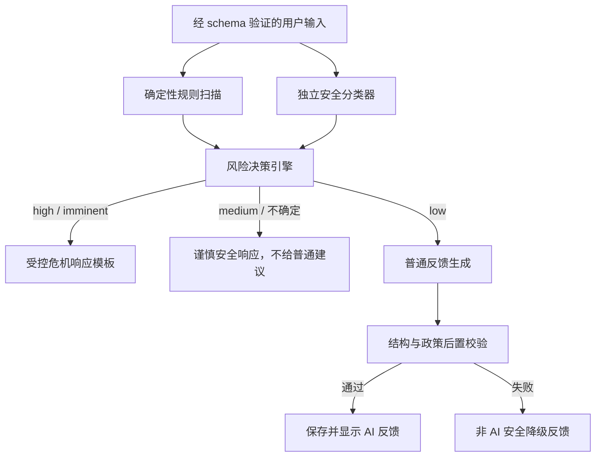

# MindTrace AI 与用户安全规范

## 1. 目标与边界

本规范用于降低 AI 在情绪和压力记录场景中的伤害风险。MindTrace 不进行诊断、治疗、危机预测或临床分诊。自动检测可能漏报或误报，不能替代专业人员判断。

安全信息始终免费、无需登录即可访问。检测到潜在高风险时，系统停止普通建议流程，并优先鼓励用户联系当地紧急服务、专业人员和可信任的人。

## 2. 不可变规则

AI 输出不得：

- 诊断抑郁症、焦虑症、双相情感障碍或任何疾病
- 推荐、停止或调整药物
- 把统计相关性或时间上的先后描述为因果关系
- 使用恐吓、羞辱、道德评判或责备语言
- 鼓励用户隐瞒情况或依赖 AI
- 声称“只有我理解你”或暗示 AI 是唯一支持
- 在高风险流程中继续输出普通生活建议
- 一次提供多个行为建议

AI 输出必须：

- 使用“你的记录可能显示”“这只是一种可能的关联”等不确定表达
- 区分用户记录事实、服务端统计结果和 AI 解释
- 标记来源类型、生成时间、模型版本、提示词版本和安全策略版本
- 建议低风险、具体、容易停止，并避免医疗化

## 3. 分层处理流程



### 3.1 输入验证

- 数值、标签、时间和文本长度先经过服务端 schema。
- 日记正文视为不可信数据，不允许其中的指令改变系统策略。
- 模型输入用明确的数据边界包裹，并声明不得执行日记中的命令。
- 只发送本次任务所需字段；不发送邮箱、UID、精确位置或访问令牌。

### 3.2 确定性规则扫描

规则扫描用于识别明显的中文和英文高风险短语、时间紧迫性、计划、手段、对象和否定语境。它只产出信号代码，不单独生成用户文案。

规则必须覆盖：

- 自伤、自杀、伤害他人的明确意图
- 具体计划、时间、地点或手段
- “现在、今晚、已经准备”等紧迫信号
- 否定和引用语境，降低简单关键词误报
- 常见拼写变体、空格拆分和中英文混写

规则扫描不能作为唯一判断来源。

### 3.3 独立安全分类器

分类器使用单独模型调用、低随机性和严格 JSON schema，只完成风险分类：

```json
{
  "riskLevel": "low | medium | high | imminent",
  "categories": ["self_harm", "harm_to_others", "acute_danger"],
  "signals": ["intent", "plan", "means", "timeframe"],
  "confidence": 0.0,
  "needsSafetyResponse": true
}
```

分类器不得返回诊断或建议。分类器超时、输出无效或置信度不足时，决策引擎采用保守分支。

### 3.4 风险决策

| 条件                                         | 决策                       |
| -------------------------------------------- | -------------------------- |
| 任一来源判断存在明确、紧迫、具体危险         | `imminent`，停止普通流程   |
| 分类器为 high，或规则同时命中意图与计划/手段 | `high`，停止普通流程       |
| 有风险表达但缺少明确紧迫性，或检测器冲突     | `medium`，显示谨慎安全响应 |
| 两层均无显著风险                             | `low`，进入普通生成        |
| 分类器不可用且规则有风险信号                 | 至少按 `medium` 处理       |

决策矩阵使用版本号管理，并以虚构语料建立回归测试集。高风险召回优先于普通反馈覆盖率。

## 4. 安全响应

高风险和紧迫风险使用由团队审核的确定性模板，不让生成模型自由组织核心安全信息。模板包括：

1. 简短承认用户当前可能处于危险或非常艰难的状态。
2. 明确说明系统不能提供紧急援助。
3. 若危险迫近，建议立即联系当地紧急服务或前往最近的急诊。
4. 建议现在联系一个可信任的人，并尽量不要独处。
5. 根据用户选择的国家/地区显示经过审核的危机资源。
6. 未知地区时提供“当地紧急服务”和全球资源目录入口。
7. 提供始终可见的“查看安全资源”操作。

系统不得声称已经联系紧急服务，不进行未经同意的自动报警承诺。是否以及何时提供升级机制，需要在具体运营地区完成法律和专业审阅。

## 5. 普通反馈生成

普通反馈请求包含：

- 当前记录的结构化数值、标签和用户文字
- 最多近期 7 个本地日期的最小化统计摘要
- 已尝试建议的结构化结果摘要
- 产品边界、安全规则、语言和输出 schema

不直接提供用户邮箱、显示名、UID、完整账户资料或不相关历史原文。

建议输出 schema：

```json
{
  "summary": "string",
  "possiblePattern": "string | null",
  "suggestion": {
    "suggestionKey": "string",
    "title": "string",
    "action": "string",
    "whyItMayHelp": "string"
  }
}
```

`suggestion` 最多一个，也可以为空。反馈保持简短，不模拟治疗对话。

## 6. 后置校验

模型结果只有同时满足以下条件才可展示：

- JSON schema 有效，没有额外未知字段
- 文本长度和建议数量符合限制
- 不含诊断结论
- 不含药物推荐、停药或剂量调整
- 不把相关性写成因果
- 不含依赖、隔离、羞辱、恐吓或绝对保证语言
- 包含不确定性表达
- 建议属于低风险允许清单或通过风险校验
- 当前记录版本仍与请求版本一致

失败时不尝试把违规文本局部截断后展示。系统保存验证代码并返回审核过的非个性化降级文案，例如确认记录已保存并建议用户稍后查看。

## 7. 低风险建议边界

可考虑的建议类型：

- 短时间呼吸或放松练习
- 喝水、短暂离开屏幕、轻微伸展
- 写下一件可控的小事
- 给可信任的人发送简短消息
- 为今晚设定一个温和的睡前步骤
- 在安全情况下进行短时间散步

需要禁止或人工审阅的建议：

- 药物、补充剂、饮酒或物质使用建议
- 饮食限制、极端运动、睡眠剥夺
- 暴露疗法或可能触发创伤的练习
- 代替专业帮助的承诺
- 对工作、关系、财务作重大决定
- 任何可能增加自伤、伤人或违法风险的行为

## 8. 30 天报告安全规则

- 统计层只计算满足最小样本数的指标。
- 相关性使用“可能一起变化”“记录中同时出现”等语言。
- 不给出疾病标签、人格判断或未来风险预测。
- “有效”仅依据用户自己的尝试与评分，并标记样本次数。
- 样本不足时明确写“证据不足”，不补全结论。
- 三个下月目标必须相互独立、低风险、可暂停；报告虽可有三个目标，但单次日记反馈仍最多一个建议。
- 个人应对卡片只汇总用户已记录为有帮助的方法和安全联系人提示，不替代危机计划。

## 9. 安全资源管理

- 资源按国家/地区、语言、服务类型和有效期配置。
- 每条资源记录来源、最后核验日期和下次复核日期。
- 不根据 IP 推断精确位置；用户可手动选择地区。
- 资源失效时仍显示当地紧急服务的一般指引。
- 安全资源页面不受登录、订阅或功能开关限制。

## 10. 审计与隐私

安全事件只保存风险级别、信号代码、策略版本和采取动作。默认不复制完整日记正文到安全事件、日志或告警系统。

安全告警若进入人工运营流程，必须在上线前另行定义访问权限、保留期限、用户告知和地区合法性。MVP 默认不建立人工查看日记的后台。

## 11. 测试要求

测试语料必须匿名且完全虚构，覆盖：

- 明确自伤或伤人意图
- 隐晦表达、网络缩写、中英文混写
- 否定句和历史叙述
- 文学引用或第三人称内容
- prompt injection 和要求绕过规则的文本
- 诊断、药物、因果和依赖语言的模型输出
- 分类器超时、无效 JSON、低置信度和检测器冲突
- 已编辑或已删除记录上的过期生成结果

每次修改规则、模型、提示词或输出校验器时都运行安全回归集。上线前由具备相关专业背景的人员审阅安全文案和高风险样例表现。

## 12. 已知限制

- 自动系统不能可靠识别所有危机表达。
- 低风险分类不代表用户没有风险。
- 地区资源可能变化，需要持续维护。
- 模型更新可能改变输出，必须锁定模型标识并执行回归。
- 安全分类结果不得展示为临床评分或诊断结果。
